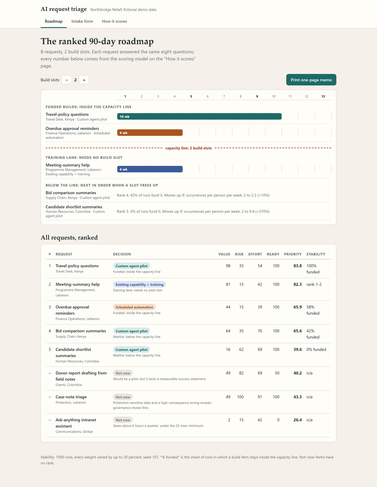
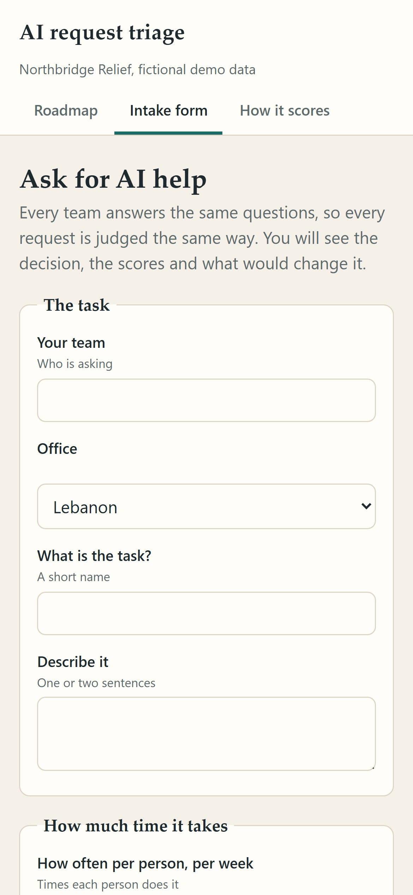

# ai-request-triage

Eight teams want AI help and there is capacity for two pilots: an intake form and a transparent scoring model that produce the ranked 90-day roadmap and say what would change it.



## The need

An AI-adoption lead gets more requests than they can serve. If the loudest team wins, the budget goes to the wrong places and the other teams cannot see why. This tool asks every team the same eight questions, scores every answer with numbers anyone can read, and gives each request a decision the requester can challenge. Each decision memo says what evidence would change it, and that part is calculated, not written by hand.

All data is synthetic: eight fictional requests from teams at Northbridge Relief, a fictional NGO.

## Try it

```
python -m venv .venv
.venv\Scripts\activate          # macOS/Linux: source .venv/bin/activate
pip install -e ".[dev]"
python -m triage serve          # http://127.0.0.1:8107, seed data loaded
```

`python -m triage report` prints the ranked roadmap in the terminal. Its real output with the seed data:

```
90-day roadmap, 2 build slots, stability from 1000 seeded runs

 1  Travel-policy questions                Custom agent pilot                           funded     83.8 100% funded
 2  Meeting-summary help                   Use an existing capability and train people  training   82.3
 3  Overdue approval reminders             Scheduled automation, no AI needed           funded     65.9 58% funded
 4  Bid comparison summaries               Custom agent pilot                           waitlist   65.6 42% funded
 5  Candidate shortlist summaries          Custom agent pilot                           waitlist   39.6 0% funded
 -  Donor report drafting from field notes Not now                                      not_now    40.2
 -  Case-note triage                       Not now                                      not_now    43.3
 -  Ask-anything intranet assistant        Not now                                      not_now    26.4
```

`pytest -q` runs the tests (58 pass). No API key, no network, no LLM.

## How it works

The intake form asks: what the task is, how often it happens, how many people do it, minutes each time, who owns the process, what information it touches, how success would be recognised, and whether a tool the team already has could do it. Two more questions make the rules possible: whether the task is fixed steps or language work, and what happens if an answer is wrong.

| Score | From | Direction |
|---|---|---|
| Value | hours a quarter = per week x 13 x people x minutes / 60, times the share a solution removes, against a 400-hour cap | higher is better |
| Risk | 0.6 x data sensitivity + 0.4 x consequence of a wrong answer | lower is better |
| Effort | 12 per system touched + task kind + data class | lower is better |
| Readiness | 50 for a named owner + 50 for a measurable success statement | higher is better |

Priority is a weighted mix: 0.45 value, 0.20 readiness, 0.20 (100 - risk), 0.15 (100 - effort). Every weight and scale is in [`triage/config.toml`](triage/config.toml) and shown on the "How it scores" page. Each memo prints the arithmetic: for travel-policy questions, `3 per week x 13 weeks x 120 people x 10 min / 60 = 780 hours`, then `780 h x 0.5 capture = 390 h saved`, then `390 / 400 x 100 = 98`.

**Routing rules.** Tried in order, first match wins. Each has a test in `tests/test_routing.py`.

| Rule | If | Route |
|---|---|---|
| R1 | saves under 25 hours a quarter | Not now |
| R2 | protection-sensitive data and a high-consequence wrong answer | Not now (governance review first) |
| R3 | language work and a tool the team already has could do it | Use the existing capability and train people |
| R4 | the same fixed steps every time | Scheduled automation, no AI (needs a named owner, else not now) |
| R5 | otherwise: language work no current tool covers | Custom agent pilot (needs a named owner and a measurable goal, else not now) |

**Capacity.** Pilots and automations are builds and each takes a slot; the default is two. Training on an existing tool takes none. Build items are ranked by priority and the top two are funded and drawn on the 13-week timeline; the rest wait below the capacity line. Change the slot count on the page and everything re-ranks.

**What would change this.** For each request the code tries every single-answer change, cheapest first (a changed category costs 1.0; a changed number costs its relative size, so a 40 percent change costs 0.4), re-ranks the whole portfolio each time, and reports the first change that alters the route and the first that moves the request across the capacity line. It also runs a seeded Monte Carlo (1000 runs, seed 107): each weight is varied by up to 20 percent, and the memo says in what share of runs the request stays funded.


### The three cases the seed data is built around

None of these has special code. `tests/test_seed.py` checks that no request title appears in `model.py`.

- **Meeting-summary help (Programme Management, Lebanon).** The team does language work (summaries) and answers "yes, a tool we already have could do it". R3 fires: use the existing capability and train people. It scores 82.3 and would rank second, but takes no build slot. The computed memo says the route changes if the answer to "could an existing tool do it" becomes "partly".
- **Travel-policy questions (Travel Desk, Kenya).** 780 hours a quarter across 120 staff, internal data, medium consequence, a named owner and a measurable goal (tickets to the desk fall 40 percent). The team says an existing tool only partly helps, because answers must cite the current policy. R5 fires: custom agent pilot. It is funded in 100 percent of runs. The smallest single change that drops it below the line is halving how often staff ask (3 to 1.5 per person per week).
- **Overdue approval reminders (Finance Operations, Lebanon).** Chasing approvers is the same fixed steps every time. R4 fires: a scheduled automation, no AI. It is funded, but only just: 58 percent of runs, and a 10 percent drop in frequency (5 to 4.5 a week) hands its slot to the bid-comparison pilot.

The other five: case-note triage hits R2 (sensitive data, high consequence); donor report drafting would be a pilot but its success statement ("better and faster") is not measurable, so R5 says not now; the intranet assistant saves about 6 hours a quarter, so R1; bid comparison and candidate shortlists are valid pilots below the line.

## Results

Measured with the seed data and `config.toml` as committed:

| Request | Route | Rank | Priority | Funded in |
|---|---|---|---|---|
| Travel-policy questions | Custom agent pilot | 1 | 83.8 | 100% of runs |
| Meeting-summary help | Existing capability + training | 2 | 82.3 | no slot used |
| Overdue approval reminders | Scheduled automation | 3 | 65.9 | 58% of runs |
| Bid comparison summaries | Custom agent pilot | 4 | 65.6 | 42% of runs |
| Candidate shortlist summaries | Custom agent pilot | 5 | 39.6 | 0% of runs |

The line between the second and third build is narrow (65.9 against 65.6 priority), so the honest reading is that those two are a near tie that the weights alone do not settle. The memos say so.

The printable one-page memo: the "Print one-page memo" button on the roadmap uses a print stylesheet that shows only the memo sheet (funded builds, training lane, below the line, not now, each with what would change it).

The intake form at phone width:



## Where it fails

- **Rule R3 ignores risk.** A request on protection-sensitive data with a medium-consequence wrong answer scores risk 80 out of 100, yet if the team says an existing tool could do it, R3 still returns "use the existing capability and train people". Risk only blocks through R2. `tests/test_known_gaps.py` pins this behaviour. A fix would be a risk ceiling on R3.
- **The search changes one answer at a time.** The intranet-assistant request has no single change that alters its route: it has no owner, no measurable goal and saves about 6 hours. The memo says "it would take several answers changing together" and cannot say which combination is cheapest.
- **Answers are self-reported.** The model scores "measurable" and "an existing tool could do it" as the team states them. The stability figure varies the weights only, not the answers, so it says nothing about a team overstating its numbers.
- The timeline durations come from a formula on the effort score, not from real delivery plans.

## What I would add next

- Let a reviewer record an override with a reason and show it next to the computed decision.
- Draft the first version of a request from a Teams thread with an LLM, then have the requester confirm each answer.

## Licence

MIT. See [LICENSE](LICENSE).
