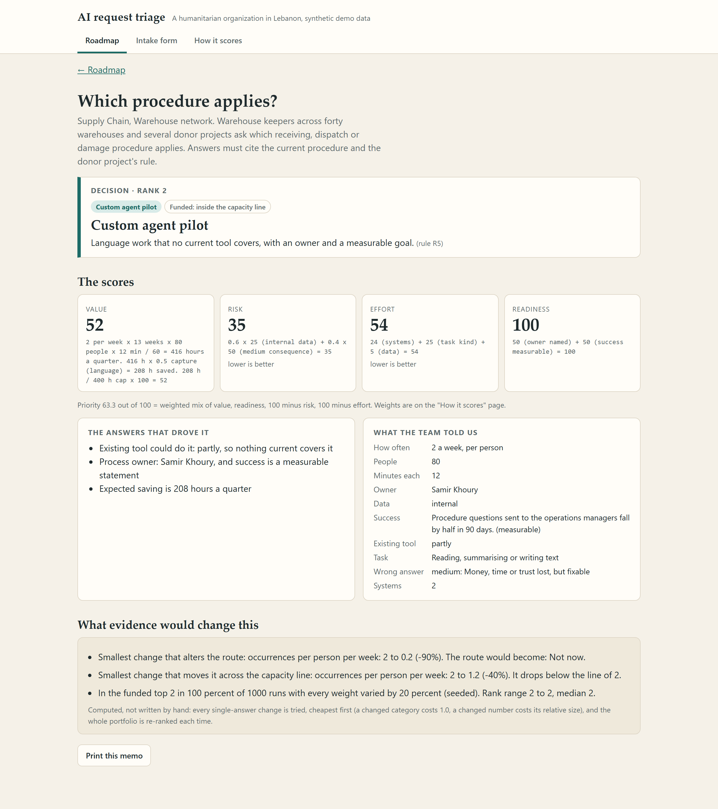
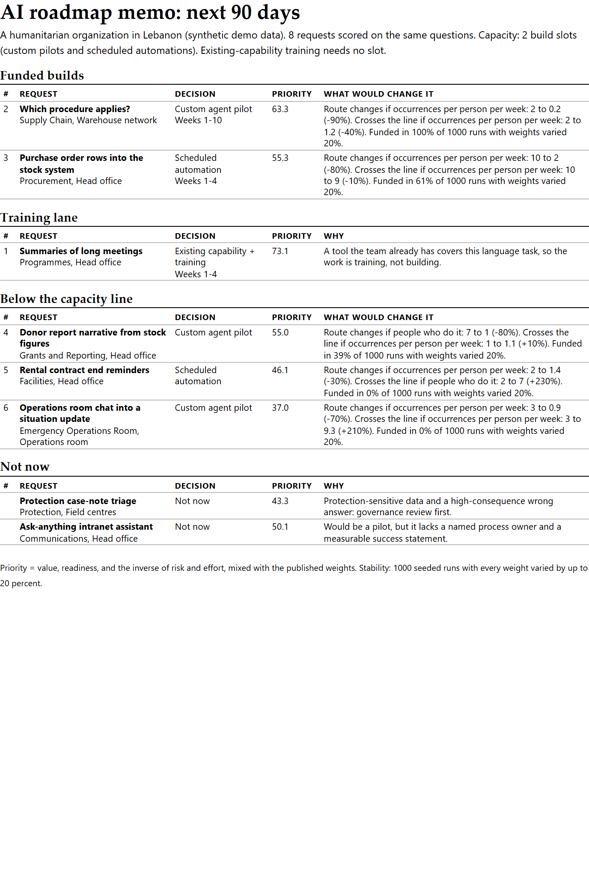

# ai-request-triage

Eight requests for AI help reach a humanitarian organization in Lebanon and there is capacity for two builds: an intake form and a transparent scoring model that produce the ranked 90-day roadmap and say what would change it.


## The need

The organization runs about forty warehouses across Lebanon, rents many premises, and coordinates emergency responses from a small operations room. Staff in each area ask for AI help, and one person has to decide which requests to serve first. If the loudest team wins, the budget goes to the wrong places and the others cannot see why. This tool asks every team the same ten questions, scores the answers with numbers anyone can read, and gives each request a decision the requester can challenge. Each memo says what evidence would change the decision, and that part is calculated, not written by hand.

All data is synthetic: the eight requests, names and figures are invented. The organization is not named.

## Try it

```
python -m venv .venv
.venv\Scripts\activate          # macOS/Linux: source .venv/bin/activate
pip install -e ".[dev]"
python -m triage serve          # http://127.0.0.1:8107, seed data loaded
```

`python -m triage report` prints the ranked roadmap in the terminal. Its real output with the seed data:

```
90-day roadmap, 2 build slots, stability from 1000 seeded runs

 1  Summaries of long meetings             Use an existing capability and train people  training   73.1
 2  Which procedure applies?               Custom agent pilot                           funded     63.3 100% funded
 3  Purchase order rows into the stock system Scheduled automation, no AI needed           funded     55.3 61% funded
 4  Donor report narrative from stock figures Custom agent pilot                           waitlist   55.0 39% funded
 5  Rental contract end reminders          Scheduled automation, no AI needed           waitlist   46.1 0% funded
 6  Operations room chat into a situation update Custom agent pilot                           waitlist   37.0 0% funded
 -  Protection case-note triage            Not now                                      not_now    43.3
 -  Ask-anything intranet assistant        Not now                                      not_now    50.1
```

`pytest -q` runs the tests (60 pass). No API key, no network, no LLM.

## How it works

The intake form asks ten questions: how often the task happens, how many people do it, minutes each time, how many systems it touches, whether it is fixed steps or language work, what information it touches, what happens if an answer is wrong, whether a tool the team already has could do it, who owns the process, and how success would be recognised (and whether that statement is measurable). It also records the team, unit and a short description.

| Score | From | Direction |
|---|---|---|
| Value | hours a quarter = per week x 13 x people x minutes / 60, times the share a solution removes, against a 400-hour cap | higher is better |
| Risk | 0.6 x data sensitivity + 0.4 x consequence of a wrong answer | lower is better |
| Effort | 12 per system touched + task kind + data class | lower is better |
| Readiness | 50 for a named owner + 50 for a measurable success statement | higher is better |

Priority is a weighted mix: 0.45 value, 0.20 readiness, 0.20 (100 - risk), 0.15 (100 - effort). Every weight and scale is in [`triage/config.toml`](triage/config.toml) and shown on the "How it scores" page. Each memo prints the arithmetic: for "Which procedure applies?", `2 per week x 13 weeks x 80 people x 12 min / 60 = 416 hours`, then `416 h x 0.5 capture = 208 h saved`, then `208 / 400 x 100 = 52`.

**Routing rules.** Tried in order, first match wins. Each has a test in `tests/test_routing.py`.

| Rule | If | Route |
|---|---|---|
| R1 | saves under 25 hours a quarter | Not now |
| R2 | protection-sensitive data and a high-consequence wrong answer | Not now (governance review first) |
| R3 | language work and a tool the team already has could do it | Use the existing capability and train people |
| R4 | the same fixed steps every time | Scheduled automation, no AI (needs a named owner, else not now) |
| R5 | otherwise: language work no current tool covers | Custom agent pilot (needs a named owner and a measurable goal, else not now) |

**Capacity.** Pilots and automations are builds and each takes a slot; the default is two. Training on an existing tool takes none. Build items are ranked by priority, the top two are funded and drawn on the 13-week timeline, and the rest wait below the capacity line. Change the slot count on the page and everything re-ranks.

**What would change this.** For each request the code tries every single-answer change, cheapest first (a changed category costs 1.0; a changed number costs its relative size, so a 40 percent change costs 0.4), re-ranks the whole portfolio each time, and reports the first change that alters the route and the first that moves the request across the capacity line. It also runs a seeded Monte Carlo (1000 runs, seed 107): each weight is varied by up to 20 percent, and the memo says in what share of runs the request stays funded.



### The requests and how they come out

None of these has special code. `tests/test_seed.py` checks that no request wording appears in `model.py`.

- **Rental contract end reminders (Facilities).** The sheet of rented premises is checked and a reminder goes out three months before each contract ends. The steps are the same every time, so R4 fires: a scheduled automation, no AI.
- **Purchase order rows into the stock system (Procurement).** Rows from the procurement sheet are pushed to the stock system, which accepts or rejects each with a reason. Same fixed steps: R4, automation, no AI. It is funded, in 61 percent of runs.
- **Which procedure applies? (Supply Chain).** Keepers in forty warehouses ask which receiving, dispatch or damage procedure applies for each donor project. It is language work, and the team says existing tools only partly help because answers must cite the current procedure. R5 fires: custom agent pilot. 416 hours a quarter, funded in 100 percent of runs.
- **Summaries of long meetings (Programmes).** Language work, and the team says a tool they already have can do it. R3 fires: use it and train people. It scores 73.1, the highest of all, but takes no build slot.
- **Donor report narrative from stock figures (Grants and Reporting).** Text plus figures, no tool covers it, owner named, measurable goal (no figure that differs from the stock ledger). R5: pilot, waitlisted, 39 percent of runs.
- **Operations room chat into a situation update.** Language work on chat that carries personal data, where a wrong update in an emergency has a high consequence. It is a valid pilot (R5) but risk 82 and low frequency put it last.
- **Protection case-note triage.** Sensitive data and a high-consequence wrong answer: R2, governance first.
- **Ask-anything intranet assistant.** About 216 saved hours a quarter, but no owner and no measure of success: R5 says not now.

## Results

Measured with the seed data and `config.toml` as committed. The seed data replaced an earlier invented scenario, so the old figures are shown beside the new ones.

| Request | Route | Rank | Priority | Funded in (1000 runs) |
|---|---|---|---|---|
| Summaries of long meetings | Existing capability + training | 1 | 73.1 | no slot used |
| Which procedure applies? | Custom agent pilot | 2 | 63.3 | 100% |
| Purchase order rows | Scheduled automation | 3 | 55.3 | 61% |
| Donor report narrative | Custom agent pilot | 4 | 55.0 | 39% |
| Rental contract reminders | Scheduled automation | 5 | 46.1 | 0% |
| Operations room chat | Custom agent pilot | 6 | 37.0 | 0% |

Earlier scenario for comparison (fictional NGO with three offices): the clearest pilot was funded in 100 percent of runs, the second automation in 58 percent, the next pilot in 42 percent and the last in 0 percent. The shape is the same: one clear winner, one near tie for the second slot (55.3 against 55.0 priority now, 65.9 against 65.6 before), and a tail that no weights reach. I adjusted the donor-report headcount (7 people, 3 hours each a week) until it sat close to the purchase-order automation so the near tie is visible; the numbers are invented either way. The honest reading is that those two are a tie that the weights alone do not settle.

**Printed memo.** The "Print one-page memo" button uses a print stylesheet that shows only the memo sheet. I rendered it with the print media type and an A4 page: it is one page, and the captured layout is in [`docs/print-layout.png`](docs/print-layout.png).



The intake form at phone width:


## Where it fails

- **A claim can flip a decision.** For the intranet assistant the cheapest route change is the answer "an existing tool could do it: no to yes". Rule R3 asks for no owner and no measure, so one changed answer turns "not now" into "use the tool and train people". The model trusts what the team says.
- **Rule R3 ignores risk.** A request on protection-sensitive data with a medium-consequence wrong answer scores risk 80 out of 100, yet if the team says an existing tool could do it, R3 still returns "use the existing capability and train people". Risk only blocks through R2. `tests/test_known_gaps.py` pins this behaviour. A fix would be a risk ceiling on R3.
- **Value counts hours, not consequences.** Rental contract reminders save only 9 value points because two people spend a few hours a week, so the cheapest and clearest automation ranks fifth. A missed contract end has a cost the model does not price.
- **The search changes one answer at a time**, and the stability figure varies the weights only, not the answers, so it says nothing about a team overstating its numbers.
- Timeline durations come from a formula on the effort score, not from real delivery plans.

## What I would add next

- Let a reviewer record an override with a reason and show it next to the computed decision.
- Draft the first version of a request from a chat thread with an LLM, then have the requester confirm each answer.

## Licence

MIT. See [LICENSE](LICENSE).
